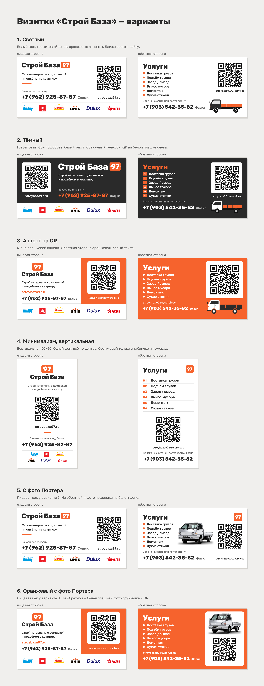

# Визитки «Строй База»

Шесть вариантов двусторонней визитки. Лицевая сторона ведёт на сайт, обратная — на страницу услуг.

Телефоны: на лицевой — заказы +7 (962) 925-87-87 (Содык), на обратной — услуги +7 (903) 542-35-82 (Фазил).

На обратной стороне вариантов 1–3 нарисован грузовичок для перевозок: векторный силуэт в фирменных
цветах, без марки и логотипов (функция `truck()` в `build.js`). В вертикальном варианте 4 места для
него нет.

Варианты 5 и 6 — с настоящим фото Hyundai Porter (`assets/porter.png`, 1024×768, в печати около 700 dpi).
Фото вставлено в PDF как есть, в RGB, края растушёваны в белый. Это картинка из интернета с
логотипом Hyundai и табличкой «Porter»: прав на неё у нас нет. Перед печатью тиража заменить на
фото своей машины (сбоку или в три четверти, на светлом фоне) — положить в `assets/porter.png`
и поправить кадр `PORTER_CROP` в `build.js`.

Внизу лицевой стороны у всех вариантов — строка логотипов брендов, которые продаёт магазин:
Knauf, Tikkurila, Момент, UNIS, Dulux, Русеан (в таком порядке, по просьбе клиента; в вертикальном
варианте — в два ряда). Файлы — в
`assets/brands/`, очищены от стилей и лишних элементов:

| Бренд | Откуда |
|---|---|
| Knauf | knauf.ru (логотип из шапки сайта) |
| Tikkurila | Wikimedia Commons, `File:Tikkurila logo.svg` |
| Момент | moment.ru (логотип из шапки сайта) |
| UNIS | unistrom.ru, сайт ГК UNIS (логотип из шапки) |
| Dulux | worldvectorlogo.com, `dulux-1.svg` — официального SVG не нашлось |
| Русеан | rusean.ru (логотип из шапки сайта) |

Логотипы — товарные знаки владельцев. Ставить их можно, если магазин действительно продаёт эти
бренды; при сомнениях уточнить у поставщика, нет ли требований к размещению. Dulux взят со
стороннего сайта — если у поставщика есть официальный файл, лучше заменить.



| Вариант | Подача | Файлы |
|---|---|---|
| 1. Светлый | Белый фон, графит, оранжевые акценты. Ближе всего к сайту | `variant-1/` |
| 2. Тёмный | Графитовый фон под обрез, оранжевый телефон, QR на белой плашке | `variant-2/` |
| 3. Акцент на QR | QR на оранжевой панели, обратная сторона оранжевая | `variant-3/` |
| 4. Минимализм | Вертикальная 50×90, всё по центру, оранжевый только в табличке | `variant-4/` |
| 5. С фото Портера | Лицевая как у варианта 1, на обратной — фото грузовика | `variant-5/` |
| 6. Оранжевый с фото Портера | Лицевая как у варианта 3, на обратной — белая плашка с фото и QR | `variant-6/` |

В каждой папке: `front.svg`, `back.svg` и `card.pdf` (стр. 1 — лицевая, стр. 2 — обратная).

## Что отдать в типографию

Только `card.pdf` выбранного варианта.

- Формат 90×50 мм (вариант 4 — 50×90), вылеты по 2 мм, лист в файле 94×54 мм. Линия реза
  записана в PDF как TrimBox, меток реза нет.
- Всё важное не ближе 4 мм к линии реза.
- Текст переведён в кривые, шрифты ставить не нужно.
- Цвета в CMYK: оранжевый 0/72/88/0, графит 0/0/0/90, QR 0/0/0/100. Оранжевый на экране и
  на бумаге отличается — попросить у типографии цветопробу.
- Рекомендуемая бумага: мелованный картон от 300 г/м², матовая ламинация. В вариантах 2 и 3
  фон под обрез, поэтому печать без белой рамки — так и сказать.

## QR-коды

| Сторона | Адрес | Код |
|---|---|---|
| Лицевая | `https://stroybaza97.ru` | уровень коррекции H, 29×29 модулей |
| Обратная | `https://stroybaza97.ru/services` | уровень коррекции Q, 29×29 модулей |

Сторона кода 20–24 мм, модуль 0,69–0,83 мм, белое поле вокруг — 4 модуля. Скрипт сборки
растеризует каждую сторону (20 и 8 точек на мм) и распознаёт код — все восемь читаются и ведут
на нужные адреса. Коды из готовых PDF тоже проверены.

Про риск из `docs/plan.md` (визитки печатаются раньше готовности сайта): в QR стоят главная и
`/services` — оба адреса на нашем домене, сайт уже работает. Если страницу придётся переносить,
ставим редирект со старого адреса на сервере, визитки перепечатывать не нужно. Путь `/services`
не переименовывать без редиректа.

## Как пересобрать

Нужен Node.js. Тексты, телефон и адреса — в начале `build.js` (блок «Содержимое»),
компоновка каждого варианта — ниже в нём же.

```bash
npm install
```

```bash
node build.js
```

Скрипт заново пишет SVG, PDF и `preview.png`, проверяет QR и отсутствие шрифтов в PDF. При
ошибке распознавания завершится с кодом 1. Шрифты Rubik ExtraBold (как в логотипе) и Golos Text
(как на сайте) ставятся из npm (`@fontsource`), лицензия OFL. Логотип берётся как есть из
`../logo/svg/`.
