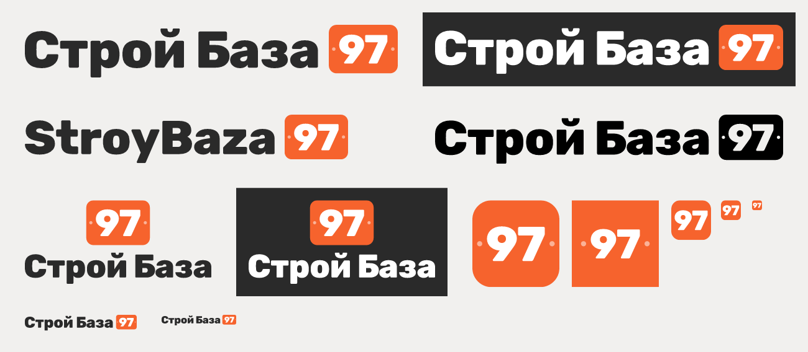

# Логотип «Строй База»

Направление «Табличка 97»: название и оранжевая табличка с номером, как на двери квартиры.
Табличка сама по себе служит значком. Направление выбрано 11 ноября 2026 из пяти,
ждёт подтверждения клиента. Все пять направлений —
[на странице вариантов](https://claude.ai/artifact/FAGWHao8TVc9fnxXeQANNw).



## Цвета и шрифт

| Что | Значение |
|---|---|
| Оранжевый | `#F6632D` |
| Графит | `#2A2A2A` |
| Шрифт названия и цифр | Rubik ExtraBold, лицензия OFL. В файлах текст переведён в кривые, шрифт ставить не нужно |

## Какой файл где

| Где | Файл |
|---|---|
| Шапка сайта, документы, накладные | `svg/logo-horizontal.svg` |
| Тёмный фон | `svg/logo-horizontal-inverse.svg` |
| Визитка, вывеска, квадратные места | `svg/logo-stacked.svg`, `svg/logo-stacked-inverse.svg` |
| Латиница, рядом с доменом | `svg/logo-horizontal-latin.svg` |
| Печать в один цвет: коробки, штампы, наклейки | `svg/logo-horizontal-mono-black.svg`, `svg/logo-horizontal-mono-white.svg` |
| Значок со скруглением | `svg/icon.svg` |
| Значок без скругления: iOS и Android скругляют сами | `svg/icon-square.svg`, `png/apple-touch-icon-180.png`, `png/icon-192.png`, `png/icon-512.png` |
| Аватар бота в Telegram (обрезается кругом) | `png/telegram-avatar-640.png`, исходник `svg/icon-circle.svg` |
| Вкладка браузера | `favicon.ico` (16, 32, 48), `svg/favicon.svg`, `png/favicon-16.png`, `png/favicon-32.png` |

В значках до 48 px шурупов нет: в таком размере они превращаются в шум.

## Правила

- Вокруг логотипа оставлять поле не меньше высоты таблички.
- Горизонтальный логотип не мельче 120 px по ширине на экране и 30 мм в печати.
- Не менять цвета местами, не растягивать, не перерисовывать «97» другим шрифтом.

## Как пересобрать

Нужен Node.js. Скрипт переводит текст в кривые и пишет все файлы заново.

```bash
npm install opentype.js@1.3.4 @resvg/resvg-js@2.6.2
```

```bash
node build.js path/to/Rubik-ExtraBold.ttf .
```

Rubik ExtraBold скачивается с Google Fonts. Размеры таблички, отступы и трекинг заданы
в начале `build.js`.
